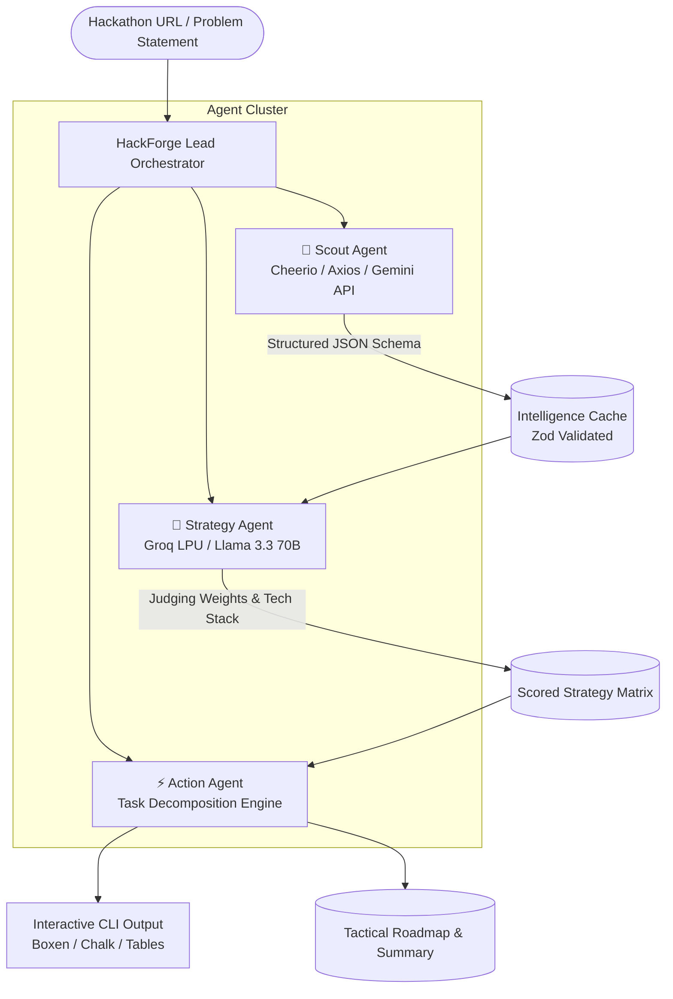

<div align="center">

# ⚡ HackForge Command System
### Autonomous Multi-Agent Intelligence & Strategic Hackathon Execution Engine

[](https://nodejs.org)
[](https://groq.com)
[](https://ai.google.dev)
[](https://github.com/Chinmay-sonar)
[](LICENSE)

*A CLI-first multi-agent orchestration platform that deconstructs complex hackathon problem statements, extracts structured judging rubrics, formulates competitive scoring strategies, and generates tactical execution plans at lightning speed.*

</div>

---

## ⚡ Overview

Competitive hackathons require rapid decision-making across ambiguous guidelines, evolving sponsor APIs, and tight submission deadlines. Solo builders and teams often fail not from a lack of technical skill, but from scope creep, unaligned judging criteria, and fragmented task management.

**HackForge** is an autonomous multi-agent command system built in Node.js. It deploys specialized agentic subroutines to ingest hackathon web portals, extract criteria with high-fidelity Zod schemas, evaluate competitive angles via high-speed Groq LPU inference, and produce actionable execution roadmaps.

---

## 🏗️ Multi-Agent Architecture



---

## 🤖 Autonomous Agent Roles

| Agent | Responsibility | Core Technology |
| :--- | :--- | :--- |
| **Scout Agent** | Crawls hackathon platforms (Devpost, Devfolio, custom sites), parses PDFs, and extracts structured rubrics (theme, rules, deadlines, sponsor APIs). | Cheerio, Axios, Google GenAI SDK, Zod |
| **Strategy Agent** | Analyzes judging weight distributions, identifies competitive differentiation angles, and scores project concepts against rubrics. | Groq SDK, LLaMA-3.3 70B Versatile |
| **Action Agent** | Translates strategic scores into hourly milestone roadmaps, API integration checklists, and submission pitch outlines. | Node.js, CLI-Table3, Boxen |

---

## 🛡️ Security & Zero-Trust Credential Isolation

- Production API keys (`.env`, `credentials.json`, `token.json`) are **strictly excluded** from source control via layered `.gitignore` rules.
- LLM API calls are stateless and run through authenticated client libraries using environment variables.
- A standardized `.env.example` file is included for quick local configuration.

---

## 🚀 Getting Started

### 1. Clone & Install
```bash
git clone https://github.com/Chinmay-sonar/hackforge-command-system.git
cd hackforge-command-system
npm install
```

### 2. Configure Environment Keys
Copy `.env.example` to `.env`:
```bash
cp .env.example .env
```
Populate `.env` with your API credentials:
```env
# Google Gemini (Structured Schema Extraction)
GEMINI_API_KEY="your_gemini_api_key_here"

# Groq Cloud (High-Speed Reasoning & Strategy)
GROQ_API_KEY="your_groq_api_key_here"
```

### 3. Run Agents

#### Test LLM Connectivity:
```bash
npm run test-llm
```

#### Run Hackathon Scout Agent:
```bash
npm run scout -- --url "https://hackathon-website-url.com"
```

#### Generate Strategy Matrix:
```bash
npm run strategy
```

#### Generate Action Roadmap:
```bash
npm run action
```

---

## 📂 System Hierarchy

```
hackforge-command-system/
├── scout-agent/
│   ├── agents/                  # Action, Intel, and Strategy modules
│   └── src/
│       ├── cli.js               # CLI argument parser & runner
│       ├── extract.js           # Gemini structured schema extraction
│       ├── fetchContent.js      # Resilient HTML & text crawler
│       └── schema.js            # Zod validation rubrics
├── action-index.js              # Action agent pipeline execution
├── strategy-index.js            # Strategy matrix synthesis (Groq)
├── test-groq.js                 # LPU inference verification test
├── .env.example                 # Sanitized configuration template
├── .gitignore                   # Multi-tier secret isolation rules
└── package.json                 # Project dependencies & scripts
```

---

## 📜 License
Distributed under the MIT License. Built with ❤️ by [Chinmay Sonar](https://github.com/Chinmay-sonar).
